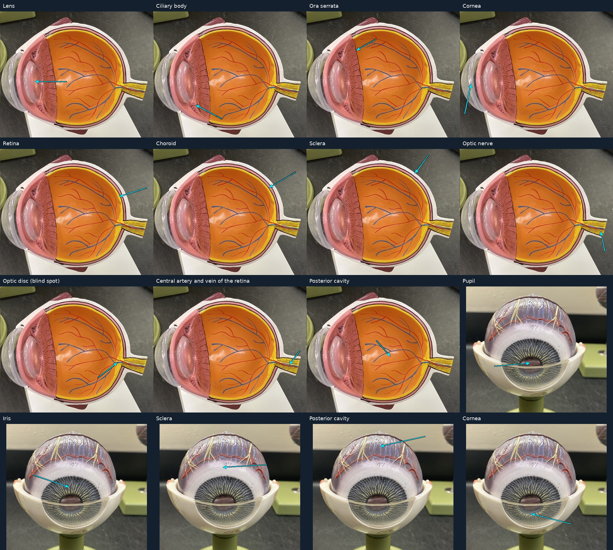

# 3D Model of Eye Anatomy

Menu: `/test` → Anatomy and Physiology Lab → Special Senses → 3D Model of Eye Anatomy.

The supplied vocabulary lists 18 views and 15 unique terms. Repeated Cornea, Sclera, and Posterior cavity entries are retained as alternate views. Sixteen cards have location markers; Macula lutea and Fovea centralis remain pending until a labeled reference establishes their distinct locations. Pending cards are excluded from quizzes and the answer-mode menu explains why.

The uploaded photograph joins two 3D-model views. Each question uses only its relevant segment: anterior view (left) or sectioned view (right). The original JPG is retained unchanged. Each PNG contains a deterministic crop and a single cyan arrow; pixels outside the arrow are unchanged from the decoded source crop. Quiz images have neutral filenames and no added answer label. Both multiple-choice and typed-answer modes are supported.

Rebuild with `python scripts/renderEyeAnatomy.py` (requires Pillow). Crop boxes, pointer coordinates, source-view metadata and image hashes are recorded in `study-data/lab-models/eye-anatomy.json`.

The reference screenshot is from https://quizlet.com/1032072514/3d-model-of-eye-anatomy-diagram/. Its dots supply approximate visible target regions but no individual selected labels. The macula/fovea pair cannot be resolved from those overlapping dots or the small model photo; no location is guessed for them. Posterior cavity refers to the vitreous chamber behind the lens and is distinct from the posterior chamber of the anterior cavity. The optic disc, optic nerve and central retinal artery/vein have separate identification cards.
