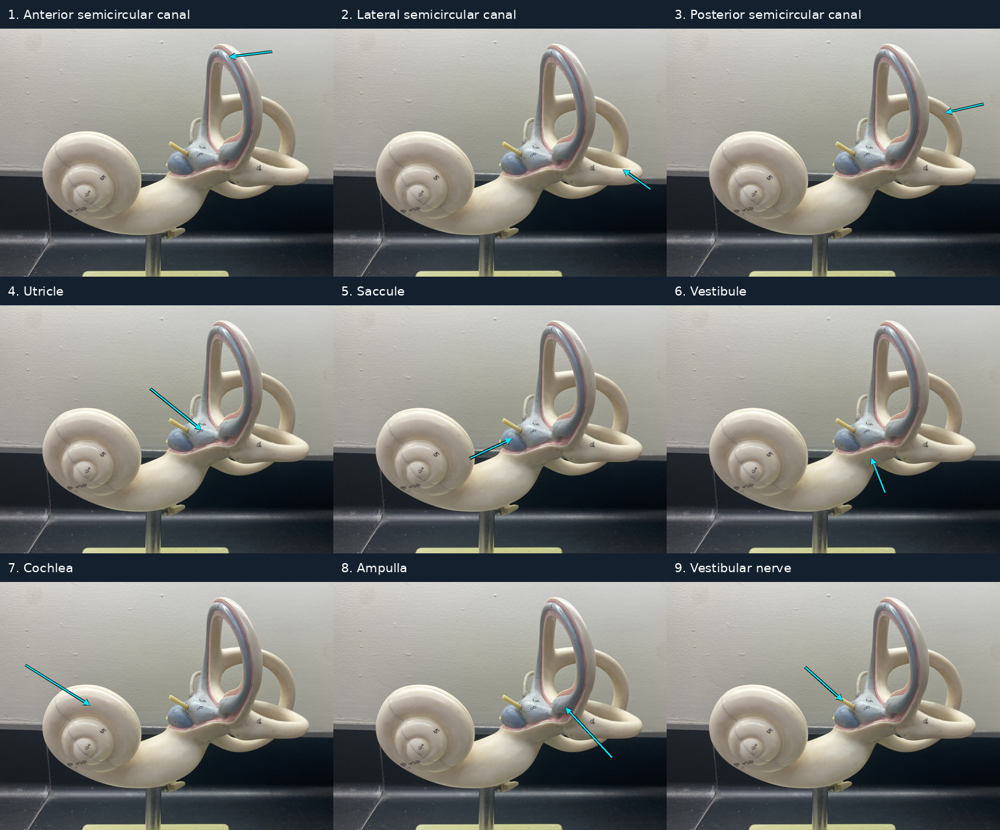

# Inner-ear lab set

Path: `/test` → Anatomy and Physiology Lab → Special Senses → 3D Structure of the Inner Ear.

Nine image-identification questions support multiple choice and typed answers. The answer-labeled preview below is for review; quiz images contain one arrow and no added answer label.

The original user photo is stored unchanged. Each quiz PNG adds only a cyan arrow with a dark outline; all pixels outside that arrow match the decoded original photograph. Rebuild with `python scripts/renderRespiratoryPointers.py inner-ear.json` (requires Pillow).

The three canals, utricle, saccule, vestibule, cochlea, ampulla, and vestibular nerve follow the supplied vocabulary. Marker placement uses the visible model and provided screenshot. Model numbers were cross-checked against the [university-hosted labyrinth key](https://bpb-us-w2.wpmucdn.com/sites.broward.edu/dist/6/45/files/2021/06/The_Labyrinth_modified.pdf) and the [SOMSO model book, page 81](https://www.doctorswriting.com/uploads/5/3/7/3/53737883/somso_anatomy_model_book.pdf). The anterior/superior canal arrow lands on the bony rim rather than the exposed membranous duct. The vestibule arrow indicates its bony chamber, not either exposed sac. The ampulla arrow indicates the expanded base of the anterior loop.
