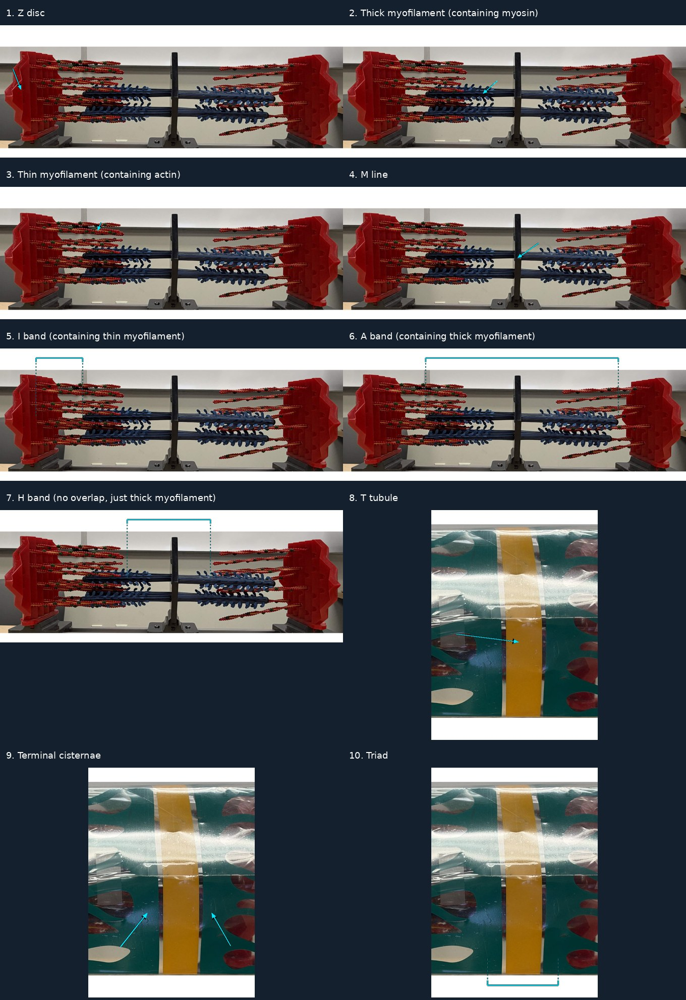

# 3D Model of Sarcomere

Menu: `/test` → Anatomy and Physiology Lab → Muscle → 3D Model of Sarcomere.

Ten image-identification cards support multiple choice and typed answers. The centered replacement sarcomere photo and the original covered-model photo are cropped to remove excess classroom background. The exposed model supplies the Z disc, thick and thin myofilaments, M line, I band, A band and H band. A close-up of the covered model supplies the T tubule, terminal cisternae and triad.

Brackets indicate regions rather than single structures. The I band marks a thin-only region; the A band spans the full thick-filament length including overlap; the H band marks a thick-only region without thin-filament overlap. Band boundaries follow the photographed model's visible filament extents rather than assuming a symmetric or uniformly contracted model. Two arrows mark the terminal cisternae, one on either side of the yellow T tubule; the triad bracket encloses all three components.

The supplied worksheet serves as the reference for region-style annotations and structure interpretation. The replacement PNG and covered-model JPG are retained unchanged; derived cards use deterministic cropping, resizing and marker overlays. JPEG cards keep the photo assets compact. Review headings are absent from quiz images and quiz filenames do not reveal answers.

Rebuild with `python scripts/renderSarcomere.py` (requires Pillow). Source hashes, crop boxes, output dimensions and pointer/bracket coordinates are recorded in `study-data/lab-models/sarcomere.json`. Typed answers include Z line/Z disk, myosin or actin filament, H zone, transverse tubule and terminal cisterna. The full descriptive H-band wording is shown in multiple choice; typed answers can use H band or H zone.
